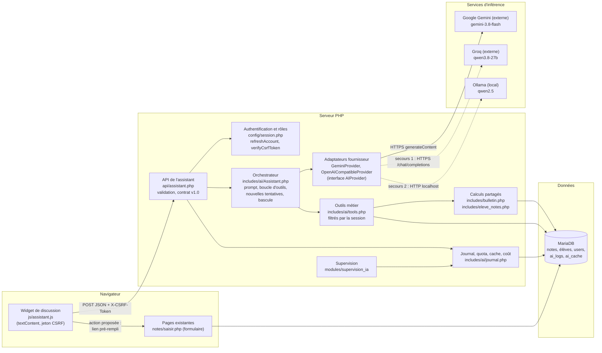
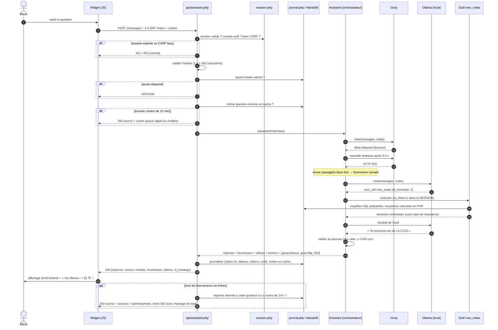
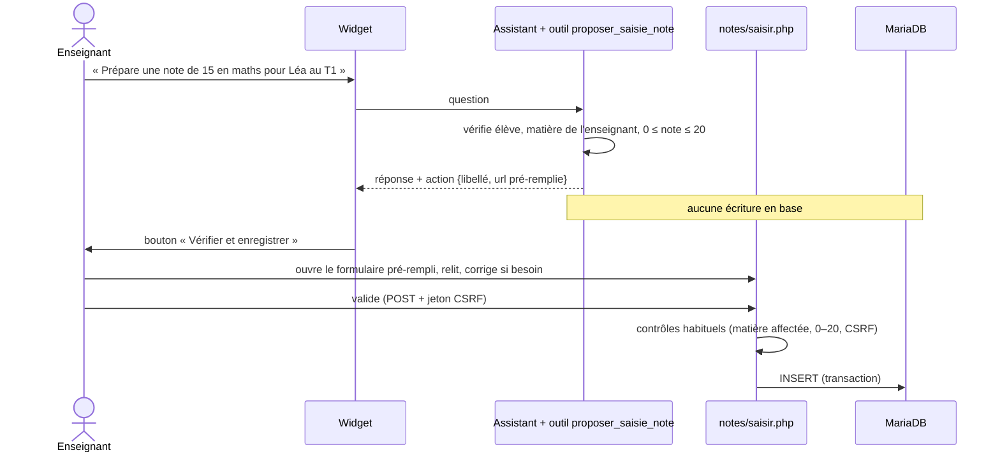

# Architecture de l'assistant IA

Les diagrammes sont en **Mermaid** : ils s'affichent directement sur GitHub, ainsi que dans VS Code avec l'extension « Markdown Preview Mermaid Support ».
Des versions **PlantUML** (UML strict) se trouvent dans [`diagrammes/`](diagrammes/). Elles s'ouvrent dans VS Code avec l'extension PlantUML, ou sur plantuml.com.

## 1. Où est l'IA ? Modèle, service d'inférence, application

| Niveau | Dans le projet | Rôle |
|---|---|---|
| **Modèle** | `gemini-3.8-flash` (Google), `qwen/qwen3.8-27b` (Groq), `qwen2.5:7b` ou `qwen2.5:3b` (Ollama) | Fichier de poids entraîné par un tiers. Il prédit du texte. Il ne connaît ni la base, ni les droits, ni l'application. |
| **Service d'inférence** | API Gemini et API Groq (cloud), serveur Ollama (`localhost:11434`) | Fait tourner le modèle et expose une API HTTP (`generateContent` chez Google, `/chat/completions` ailleurs). Il est remplaçable. |
| **Application intelligente** | `api/assistant.php`, `includes/ai/*`, `js/assistant.js` | Authentification, droits, outils métier, validation, secours, cache, journal, interface. **C'est ici que se trouve la logique.** |

Le modèle ne lit jamais la base de données. Il **demande** l'exécution d'un outil. L'application vérifie la demande, exécute la requête SQL avec les droits de la session, puis renvoie le résultat au modèle.

## 2. Diagramme de composants

Il s'agit d'une **architecture hybride** :
- **services externes** en premier (Gemini, puis Groq : modèles plus gros, rapides, offre gratuite, aucune charge sur la machine, mais les données quittent l'établissement) ;
- **modèle local** en dernier secours (Ollama : aucune donnée ne sort, aucun coût par question, mais il faut une machine équipée).

L'ordre se règle dans `.env` (`AI_PROVIDERS=gemini,groq,ollama`). On peut l'inverser, ou passer en tout-local, sans toucher au code.

## 3. Diagramme de séquence d'une requête

Exemple : un élève demande « Quelle est ma moyenne au 1er trimestre ? ». Groq est indisponible.

## 4. Flux d'une action sensible (saisie de note)

Le modèle ne peut rien écrire : aucun outil n'a de droit en écriture. La seule écriture possible passe par le formulaire existant, après validation humaine.

## 5. Composants d'une application intelligente

| Composant | Fichiers | Responsabilité |
|---|---|---|
| Interface | `js/assistant.js`, `css/style.css` | Saisie, affichage sûr (`textContent`), indication de la source, avis, actions à confirmer |
| Logique métier | `includes/ai/tools.php`, `includes/bulletin.php`, `includes/eleve_notes.php` | Droits, calculs (moyennes, rangs), validations. **Rien de tout cela n'est dans le prompt** |
| Service d'IA | `includes/ai/AIProvider.php`, `OpenAICompatibleProvider.php`, `Assistant.php` | Contrat avec le modèle, boucle d'outils, nouvelles tentatives, bascule |
| Données | Tables existantes + `ai_logs`, `ai_cache` (`sql/database.sql`) | Source de vérité ; journal sans texte des questions ; cache limité à 24 h |
| Authentification | `config/session.php` | Session, rôles, CSRF, compte relu à chaque appel |
| Supervision | `modules/supervision_ia/index.php`, `scripts/eval_assistant.php` | Disponibilité, latence, coûts, avis, signalements, évaluation hors ligne |
| Configuration | `.env` | Fournisseurs, modèles, délais, quotas, tarifs : modifiables sans changer le code |
